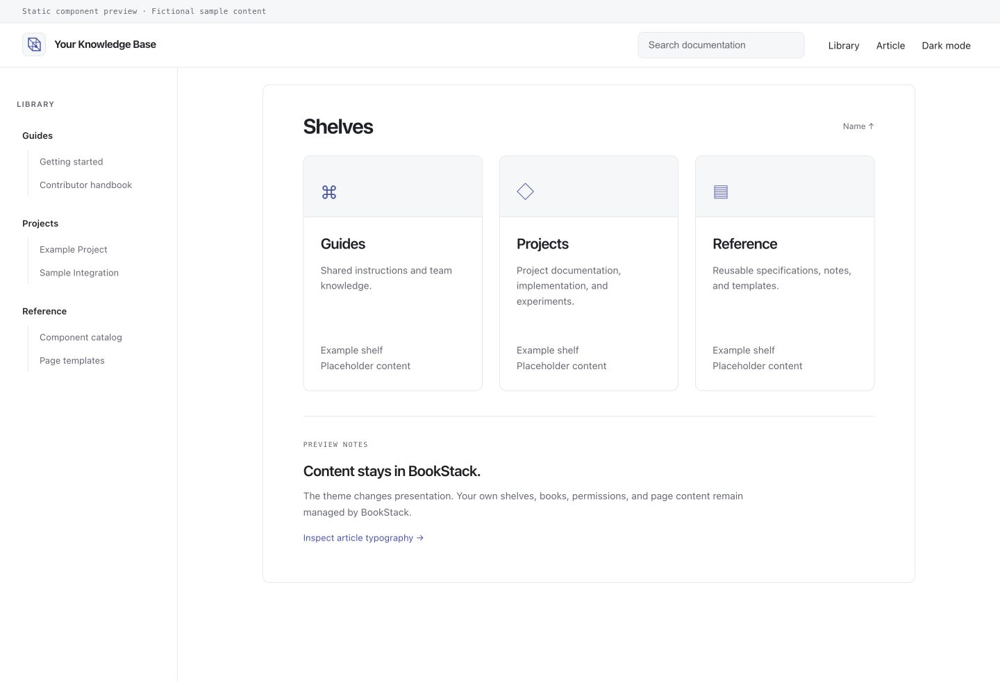
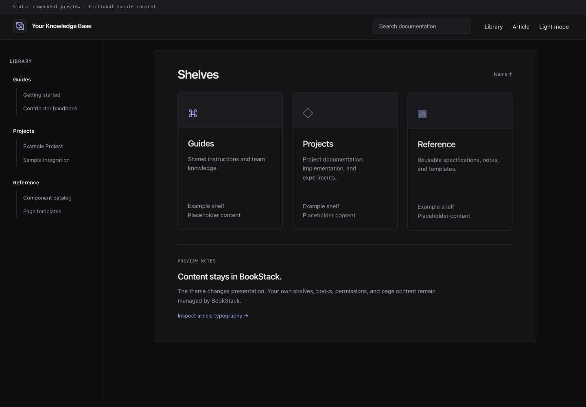

# BookStack Linear Theme

A restrained documentation theme for BookStack: native system typography, Swiss
spacing, muted indigo accents, a grouped library sidebar, and subtle CSS motion.
Inspired by contemporary developer documentation; not affiliated with Linear.




## What is included

- Light/dark surfaces with a continuous full-document background.
- A 760px reading column, clear heading levels, and system monospace code.
- Coordinated header, search, cards, article navigation, and active-page indicators.
- Homepage shelf → book directory using the reader's existing permissions.
- Short entrance/stagger effects, hover lifts, and smooth anchor scrolling.
- Reduced-motion support. No custom JavaScript, remote fonts, or external assets.
- A generic geometric mark when no custom logo is configured.
- Preserved site title, custom logo, custom head setting, and native content tools.

There are no slogans, fixed shelf names, sample accounts, content migrations,
database dumps, credentials, hostnames, or real-site screenshots in this package.
The theme displays the names and content already configured in your BookStack.
It does not restrict the available interface languages or reorganize your books.

## Preview

Open `preview/index.html` directly, or serve it locally:

```sh
python3 -m http.server 8000 --bind 127.0.0.1 --directory preview
```

Visit `http://127.0.0.1:8000`. Use the light/dark and library/article links to
inspect components. Everything in this preview is fictional placeholder content.
The preview uses the actual theme CSS over a small illustrative layout; it is
**not a running BookStack instance**, and its controls do not perform wiki actions.
The screenshots above show that static preview. The source theme was exercised
on BookStack v26.09.2; verify it against your own deployment before wider use.

## Install

An existing BookStack installation and Python 3.9+ are required for the helper.
The theme itself needs no Python, Node, build step, or additional packages.

```sh
# Replace YOUR_GITHUB_USER with the owner of your repository.
git clone https://github.com/YOUR_GITHUB_USER/bookstack-linear-theme.git
cd bookstack-linear-theme
python3 scripts/install.py --themes-dir /PATH/TO/BOOKSTACK/themes
```

Set `APP_THEME=linear` in your effective, persistent BookStack configuration, then
clear compiled views from the application directory with `php artisan view:clear`.
For LinuxServer.io containers, the persistent theme directory is
`/config/www/themes`; use its actual host-side path and the image's artisan path.

**Read [deployment and rollback](docs/DEPLOYMENT.md)** for native and Docker
commands, preserving an existing theme, updates, and verification. The helper
installs theme files only; it does not modify configuration or restart services.

## Deploy with an AI assistant

Use the [ready-to-paste deployment prompt](docs/AI_DEPLOY.md). Fill in your own
deployment type and paths locally. It asks the assistant to inspect the existing
installation, preserve customizations, install without touching unrelated services,
verify real pages, and leave clear rollback steps. Do not include secrets in it.

## Customize

Colors, fonts, and reading geometry live in
`theme/layouts/parts/linear-styles.blade.php`. Interface/motion rules are in
`linear-interface.blade.php`. The homepage directory is
`theme/home/parts/linear-directory.blade.php`; it sorts visible shelves by name
and preserves native book ordering. Replace the geometric mark in `header-logo`
or use BookStack's own custom logo setting. No theme file needs your site name.

## Build a ZIP

```sh
python3 scripts/build_preview.py
python3 scripts/package.py
```

The ZIP and SHA-256 file appear in `dist/`. Packaging uses an explicit allowlist
and excludes Git metadata and local build/cache files. Review your changes before
sharing a customized build. Installer checks run with:

```sh
python3 -m unittest discover -s tests -v
```

## Compatibility and license

Tested baseline: **BookStack v26.09.2**, including its LinuxServer.io image.
Template overrides and internal model relations can change on upgrades; see the
deployment guide. Administrative customization settings keep their native styles,
and export/PDF appearance is outside this theme's scope.

MIT licensed. See [LICENSE](LICENSE) and [third-party notices](THIRD_PARTY_NOTICES.md).
